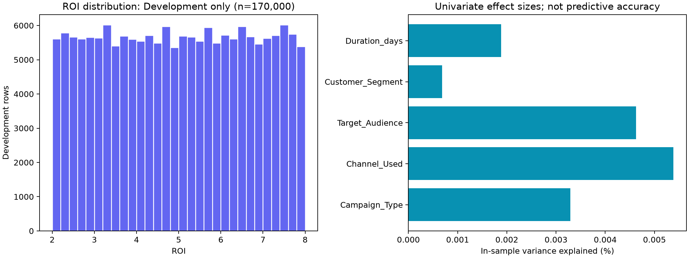
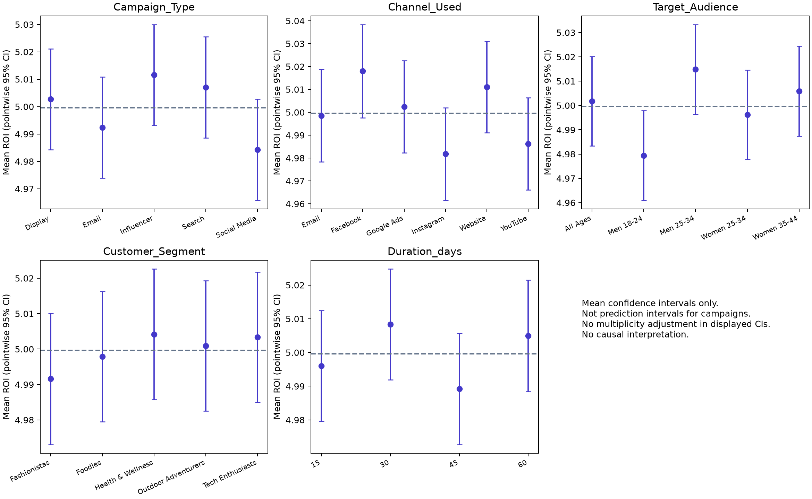

# PHASE 4B.1 — Kiểm tra dữ liệu và bảo vệ tập Test

Ngày nghiên cứu: **03/11/2026**, Asia/Bangkok. Trạng thái triển khai giữ **BASELINE_ONLY**.

**Kết luận:** CSV đủ sạch về cấu trúc để nghiên cứu, nhưng chưa có căn cứ cho tối ưu Marketing thực tế. Split gốc đã khôi phục chính xác từ gói Colab. Tất cả thống kê phân phối, liên hệ ROI và kiểm tra chéo mới dưới đây chỉ sử dụng **Development 170.000 dòng**.

## 1. Nguồn và phạm vi

- CSV gốc: thư mục MachineLearning cấp trên, `marketing_campaign_dataset.csv`.
- Notebook gốc: `C:/Users/ASUS/Downloads/MachineLearningcki (8).ipynb`.
- Gói Colab: `C:/Users/ASUS/Downloads/models_roi (4).zip`, chứa `splits/data_splits.joblib`. Ba pipeline trong gói khớp SHA256 với Linear Regression, Decision Tree và Random Forest đang triển khai.
- Metadata/metrics và kết quả Phase 1 hiện có được đọc, không sửa.
- Các báo cáo PDF hiện có chỉ được dùng để đối chiếu phương pháp, không thay thế bằng chứng số mới. Báo cáo ROI trang 1–4 đã ghi nhận thiếu định nghĩa ROI và chưa rõ nguồn gốc dữ liệu. PDF thực hành Super Machine Learning ở trang 23–24 nói về **California Housing**, không phải benchmark ROI; không chuyển kết quả tốt của bài toán nhà ở sang DreamMakers.

SHA256 nguồn:

| Nguồn | SHA256 |
|---|---|
| marketing_campaign_dataset.csv | `f06c1b95a8207b4631c35e6b83b4a2a7872892a8bfa133967e1e7ec401c7bb60` |
| MachineLearningcki (8).ipynb | `f66eace5d41e3a09b1b44ea51d2402ad8cee729551547b2aa3c2db56b2c22469` |
| models_roi (4).zip | `9e793ec2c903e6d56b47583fa8a1c23be1ba5ad0d4f303f3d28a1ee58234bbb0` |

## 2. Kiểm tra cấu trúc toàn bộ CSV

| Kiểm tra | Kết quả |
|---|---|
| Số dòng | 200.000 |
| Số cột | 16 |
| Missing toàn bộ ô | 0 |
| Duplicate toàn dòng | 0 |
| Campaign_ID trùng | 0 |
| ROI không hữu hạn bị loại khi replay cleaning | 0 |

Toàn bộ cột và kiểu dữ liệu khi đọc bằng pandas:

| Cột | dtype gốc | Missing |
|---|---|---|
| Campaign_ID | int64 | 0 |
| Company | object | 0 |
| Campaign_Type | object | 0 |
| Target_Audience | object | 0 |
| Duration | object | 0 |
| Channel_Used | object | 0 |
| Conversion_Rate | float64 | 0 |
| Acquisition_Cost | object | 0 |
| ROI | float64 | 0 |
| Location | object | 0 |
| Language | object | 0 |
| Clicks | int64 | 0 |
| Impressions | int64 | 0 |
| Engagement_Score | int64 | 0 |
| Customer_Segment | object | 0 |
| Date | object | 0 |

Kiểm tra toàn CSV giới hạn ở schema, missing, duplicate, khóa định danh và bước làm sạch bắt buộc để phát lại notebook. Việc kiểm tra ROI hữu hạn ở bước này là kiểm tra hợp lệ, không phải khảo sát phân phối để chọn feature. Không trình bày trung bình/phân phối ROI hoặc quan hệ feature–ROI của Test cuối.

`Duration`, `Acquisition_Cost`, `Date` là object, cần chuyển kiểu. `Duration_days` được tách đúng biểu thức `Duration.str.extract(r'(\d+)').astype(int)`. Chi phí được bỏ ký hiệu tiền tệ/dấu phẩy/khoảng trắng; ngày được parse trên Development. Không tạo đặc trưng ROI giả hoặc tái tạo doanh thu bằng cách lấy ROI làm đầu vào.

## 3. Khôi phục đúng split đã lưu

Notebook cell 91/115: loại trùng toàn dòng và ROI không hữu hạn; không reset thứ tự hàng. Cell 104/117: chia 70%/30% với `random_state=42`, rồi chia phần tạm làm đôi với cùng seed. Script không thực thi notebook chứa lệnh fit/dump.

| Partition | Số dòng | Khớp index + thứ tự với archive |
|---|---|---|
| Train | 140.000 | PASS |
| Validation | 30.000 | PASS |
| Test cuối (khóa) | 30.000 | PASS — chỉ đối chiếu index |
| Development = Train + Validation | 170.000 | PASS — không giao Test |

Đối chiếu **toàn bộ index và thứ tự**, không chỉ kích thước. Các giá trị năm feature và ROI của Train/Validation còn khớp bản lưu theo từng hàng. Khác biệt tên hiển thị của trục cột trong notebook được bỏ qua khi so sánh; tên cột, dtype, giá trị và index vẫn được kiểm tra.

SHA256 `data_splits.joblib`: `578a792a63aed7e9787edab351f9301547908952b2293619146587d413ee6f84`.

Các tập không giao nhau. `split_membership.csv` lưu chỉ số hàng CSV tính từ 0 và partition; `development_fold_membership.csv` lưu fold chẩn đoán mới. Hai file không chứa ROI. File split joblib nguyên khối được nạp để lấy index; không đọc giá trị hoặc thống kê từ `X_test/y_test`, và các đối tượng này bị loại khỏi phạm vi phân tích ngay sau đối chiếu index.

**Development cho chẩn đoán mới = Train gốc nối Validation gốc**, giữ thứ tự trong từng tập. Đây là lựa chọn thứ tự công khai cho thí nghiệm mới, không được gán ngược cho CV lịch sử khi chưa có bằng chứng.

## 4. Phân phối ROI — chỉ Development

| Thống kê Development | ROI |
|---|---|
| Số dòng | 170.000 |
| Trung bình | 4,999618 |
| Độ lệch chuẩn mẫu | 1,734479 |
| Nhỏ nhất | 2,000000 |
| P01 | 2,060000 |
| P05 | 2,290000 |
| Q1 | 3,490000 |
| Trung vị | 5,000000 |
| Q3 | 6,500000 |
| P95 | 7,690000 |
| P99 | 7,940000 |
| Lớn nhất | 8,000000 |

ROI có 601 mức trên lưới 0,01, trong [2; 8], phân phối gần đều, không phải tập trung kiểu chuẩn quanh 5. Skewness khoảng −0,00360 và excess kurtosis khoảng −1,20413. Độ lệch chuẩn gần 1,73205 của Uniform(2,8) là một đối chiếu hình dạng, không phải xác nhận cơ chế sinh.

Kiểm tra chi-square thăm dò trên **12 bin cố định** cho p≈0,8264; chưa thấy khác biệt đáng kể với tần suất bin đều. Kiểm tra thô này không chứng minh phân phối đều chính xác, tính độc lập, hoặc dữ liệu chắc chắn là tổng hợp. Làm tròn ROI cũng ảnh hưởng kỳ vọng ở biên.



## 5. Phân phối năm feature — chỉ Development

| Feature | Giá trị | Số dòng Development | % |
|---|---|---|---|
| Campaign_Type | Display | 34.012 | 20,007 |
| Campaign_Type | Email | 33.818 | 19,893 |
| Campaign_Type | Influencer | 34.121 | 20,071 |
| Campaign_Type | Search | 34.085 | 20,050 |
| Campaign_Type | Social Media | 33.964 | 19,979 |
| Channel_Used | Email | 28.470 | 16,747 |
| Channel_Used | Facebook | 27.954 | 16,444 |
| Channel_Used | Google Ads | 28.433 | 16,725 |
| Channel_Used | Instagram | 28.404 | 16,708 |
| Channel_Used | Website | 28.409 | 16,711 |
| Channel_Used | YouTube | 28.330 | 16,665 |
| Target_Audience | All Ages | 34.044 | 20,026 |
| Target_Audience | Men 18-24 | 34.177 | 20,104 |
| Target_Audience | Men 25-34 | 34.081 | 20,048 |
| Target_Audience | Women 25-34 | 33.933 | 19,961 |
| Target_Audience | Women 35-44 | 33.765 | 19,862 |
| Customer_Segment | Fashionistas | 33.683 | 19,814 |
| Customer_Segment | Foodies | 34.188 | 20,111 |
| Customer_Segment | Health & Wellness | 33.935 | 19,962 |
| Customer_Segment | Outdoor Adventurers | 34.092 | 20,054 |
| Customer_Segment | Tech Enthusiasts | 34.102 | 20,060 |
| Duration_days | 15 | 42.296 | 24,880 |
| Duration_days | 30 | 42.603 | 25,061 |
| Duration_days | 45 | 42.685 | 25,109 |
| Duration_days | 60 | 42.416 | 24,951 |

Danh mục đầy đủ của các cột bổ sung và thống kê nhóm ROI có trong `outputs/phase4b1/development_group_statistics.csv`. Khoảng tin cậy trong file/biểu đồ là khoảng cho **trung bình nhóm**, mang tính pointwise, chưa hiệu chỉnh đa kiểm định; không phải khoảng dự đoán ROI từng chiến dịch.



## 6. Dấu hiệu cần xác minh về nguồn gốc

1. Trong **100% Development**, `Date = 2021-01-01 + ((Campaign_ID - 1) mod 365)` ngày. Đây là bằng chứng trực tiếp ngày được sắp theo một quy luật vòng lặp của ID trong mẫu đã phân tích. Không thể coi `Date` là lịch triển khai tự nhiên để suy ra mùa vụ nếu chưa có giải thích của bên tạo dữ liệu.
2. Development chỉ có ngày từ 01/01/2021 đến 31/12/2021; không có bằng chứng cho khái quát hóa sang nhiều năm hoặc điều kiện thị trường hiện tại.
3. ROI gần đều, giới hạn tròn và hai chữ số thập phân; nhiều biến có miền giá trị gọn; các liên hệ quan sát với ROI rất yếu. Các đặc điểm này **phù hợp với giả thuyết dữ liệu được tạo theo khuôn**, nhưng không đủ chứng minh dữ liệu giả hoặc tất cả các biến được sinh độc lập.
4. Không có cột doanh thu, lợi nhuận gộp, ngân sách dự kiến hay số khách hàng chuyển đổi riêng để xác minh công thức ROI, đơn vị và cửa sổ ghi nhận. Không suy doanh thu từ chính ROI rồi dùng làm feature.

Không tìm thấy tài liệu sơ cấp đủ để xác nhận quy trình sinh dữ liệu; truy cập trang nguồn Kaggle chưa cung cấp nội dung có thể kiểm chứng trong phiên này. Không lấy nhận xét của các bản mirror hoặc project khác làm bằng chứng xác nhận tính tổng hợp.

## 7. Tính độc lập lịch sử và truy vết CV

Notebook chứa EDA trên toàn bộ `df_clean` trước split (ví dụ cell 62/80/84) và thử nghiệm tham chiếu 80/20 ở cell 86. Một số cell có output lưu nhưng `execution_count` trống, nên không xác minh được hoàn toàn trình tự thực thi. Đây là giới hạn của hồ sơ lịch sử: không thể tuyên bố Test cuối chưa từng bị ảnh hưởng gián tiếp bởi quan sát EDA trước đây. Nghiên cứu mới không thực thi lại các cell đó và không dùng Test cho phát triển.

Notebook có KFold **3-Fold** phục vụ tuning tại cell 147, nhưng không có mã/fold manifest tạo bảng **5-Fold trên 170.000 dòng** trong `model_metrics.json`. Kiểm tra chéo mới có kết quả khác bảng đã công bố:

| Mô hình | RMSE công bố (giữ nguyên) | RMSE chẩn đoán mới | Chênh |
|---|---|---|---|
| Dummy Regressor | 1,732275 | 1,734474 | 0,002199 |
| Linear Regression | 1,732384 | 1,734586 | 0,002202 |

Các con số gốc được giữ nguyên byte. Chưa xác định được nguồn chênh lệch: cần notebook tạo metrics, phiên bản CSV, danh sách Development và fold gốc, cùng công thức tổng hợp. **Không giải thích chênh lệch bằng cách thử nhiều split để khớp số**, và không mở Test để tìm nguyên nhân. Một seed giống nhau hoặc số lượng dòng giống nhau không đủ xác nhận cùng giao thức CV.

## 8. Tái lập và kiểm tra nguyên vẹn

| Thành phần | Phiên bản đã chạy |
|---|---|
| Python | 3.13.17 |
| numpy | 2.4.6 |
| pandas | 2.2.3 |
| scipy | 1.18.1 |
| scikit-learn | 1.6.1 |
| joblib | 1.6.0 |
| matplotlib | 3.11.2 |

Lệnh từ thư mục dự án:

```powershell
# Thư viện bổ sung đặt riêng, không cài vào backend/.venv
& .\backend\.venv\Scripts\python.exe -m pip install --target research/.deps --no-deps -r research/requirements-extra.txt
& .\backend\.venv\Scripts\python.exe -X utf8 research/scripts/audit_phase4b1.py
& .\backend\.venv\Scripts\python.exe -X utf8 research/scripts/review_sources.py
& .\backend\.venv\Scripts\python.exe -X utf8 research/scripts/render_reports.py
& .\backend\.venv\Scripts\python.exe -X utf8 research/scripts/check_results.py
```

Script chính hỗ trợ `--dataset`, `--notebook`, `--archive`. Thay nguồn mà không khớp SHA256/index sẽ dừng; không tự tạo split khác. 199 phép hoán vị dùng seed 20261103; CV chẩn đoán dùng KFold(5, shuffle=True, random_state=42). Không có hyperparameter search, không fit đối tượng production, không lưu/thay thế pipeline mới.

**66 tệp ứng dụng/metadata/artifact được đối chiếu SHA256 trước–sau và không đổi**; chi tiết trong `outputs/phase4b1/integrity.json`. CSV/notebook/archive và các PDF được đọc cũng được kiểm tra hash. Chỉ tạo tệp trong `research/`. Quality Gate giữ BASELINE_ONLY.

Đã chạy lại toàn bộ phân tích thành công: **sáu tệp kết quả số khớp SHA256 giữa hai lần chạy** (`reproducibility_check.json`). Bộ kiểm tra đầu ra có **39 kiểm tra PASS**, gồm không có Test trong assessment folds, mỗi Development row được đánh giá đúng một lần, tổng số dòng từng nhóm và công thức tổng hợp metric (`verification_checks.json`). PASS ở đây xác nhận quy trình nghiên cứu/tính nguyên vẹn, không xác nhận mô hình đạt Quality Gate.

## 9. Blocker còn lại

- Chưa có provenance đủ cho bộ metrics 5-Fold đã công bố; cần đối chiếu trước mọi quyết định nâng cấp.
- Thiếu định nghĩa ROI, công thức, cửa sổ outcome và nguồn dữ liệu thực/tổng hợp.
- Thiếu xác nhận thời điểm biết được `Duration`, `Date`, `Acquisition_Cost` và các snapshot trước chiến dịch.
- Test gốc được khóa cho nghiên cứu mới, nhưng hồ sơ EDA lịch sử chưa bảo đảm blinded hoàn toàn; nghiệm thu khuyến nghị cần thêm dữ liệu độc lập mới.
- Dữ liệu chưa có log phân bổ ngẫu nhiên/propensity, đối chứng hay ngân sách và lợi nhuận để đánh giá chính sách triển khai.

Những blocker này ngăn nâng Quality Gate/khuyến nghị tối ưu, không ngăn hoàn thành báo cáo khả thi Phase 4B.1.
