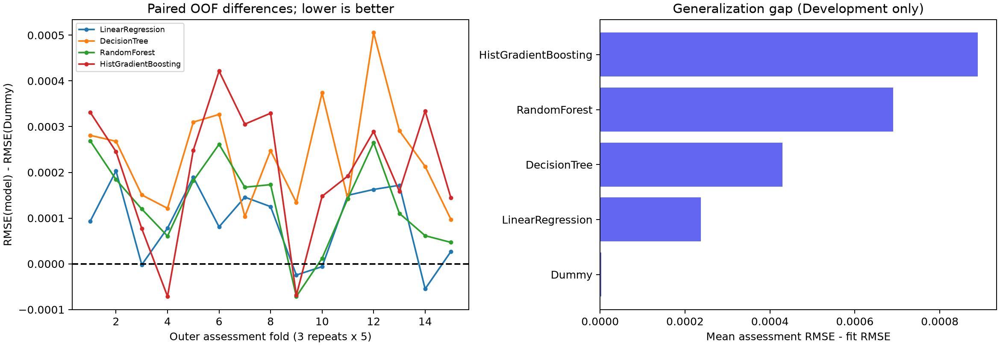

# PHASE 4B.2 — Thực nghiệm cải thiện mô hình ROI

Ngày: **03/11/2026**, Asia/Bangkok. Experiment: **DM-ROI-PHASE4B2-CURRENT5-001**.

**Trạng thái thực thi: COMPLETE — đủ 5 mô hình, 360 fit inner và 75 outer refit trên Development.** Không có fold nào bị giảm hoặc bỏ qua. **Mục tiêu vượt Dummy ổn định: chưa đạt. Quality Gate giữ BASELINE_ONLY.**

Đây là benchmark mới theo DM-DEV-170K-v1, không thay thế hay “sửa lại” bảng lịch sử 1,732275 chưa tái lập được. Không thực hiện tối ưu hoặc thay model production.

## 1. Nguồn, giao thức và kiểm tra trước khi fit

Đã đọc ba báo cáo Phase 4B.1, báo cáo đối soát Phase 4B.1A, code notebook MachineLearningcki (8) và metadata/metrics gốc. Các giới hạn về provenance lịch sử và planned/actual Duration vẫn được giữ trong kết luận.

Protocol đóng băng đã được kiểm tra đầy đủ trước fit: hash CSV, membership gốc, ordered Development IDs, lịch outer và công thức seed inner. **Không có blocker về tính toàn vẹn của giao thức mới.** Các FAIL nguồn gốc của benchmark cũ không được đổi thành PASS và không dùng để chặn hay chọn cấu hình của run mới.

| Evidence | SHA256 |
| --- | --- |
| common.py | 87e3e5dace31da8d62afc89d345c01408132ddb0b630bb17f101d8b66860828a |
| run_experiment.py | 6942ae8d65a656ebf55717cdb867436c3775ca2421abfa9cefa1f5907fd46027 |
| experiment_config.json | 9cabbdf6266f33743054c4936dea897c8ba65fb249995718b8e2180f3eb2da95 |
| phase4b2_evaluation_protocol.json | 9114f91eb9f393ac5e65ec63def4fe5dbdcf974d627461ddcfe952a8daf4c9bb |
| protocol_sha256 | 9114f91eb9f393ac5e65ec63def4fe5dbdcf974d627461ddcfe952a8daf4c9bb |
| config_sha256 | 9cabbdf6266f33743054c4936dea897c8ba65fb249995718b8e2180f3eb2da95 |
| dataset_sha256 | f06c1b95a8207b4631c35e6b83b4a2a7872892a8bfa133967e1e7ec401c7bb60 |
| membership_sha256 | 7d5def28615c7a35f2a5e1cbe6167c81f5fc6d1ee117855a5f6f4d62fabf7f17 |
| schedule_sha256 | 2fd371979ddcba94b907308209cd2c18b958e1f539c84a8143844ae63bed9e96 |
| development_order_sha256 | ab9ad10f48531464b11a35d9328e7e85af69b2e85dfecbf5894da145399a697b |

- Development 170.000 dòng = Train gốc 140.000 nối Validation gốc 30.000, giữ order.
- Outer KFold(5, shuffle=True), seeds **42, 2026, 20261103**. Mỗi fit 136.000, assessment 34.000.
- Inner 3-Fold; seed **100000×repeat + 1000×outer_fold +17**; số thứ tự từ 1. Inner fit 90.666/90.667, validation 45.334/45.333 dòng, nằm hoàn toàn trong outer fit.
- Model random_state khóa trước **314159**; một fit tại một thời điểm, ngân sách **2 thread**. Không đổi seed khi thấy kết quả.
- Metric chính: mean RMSE của năm outer fold mỗi repeat, rồi mean ba repeat. Không làm tròn trước tổng hợp. Pooled OOF lưu riêng.
- Các lịch indices/hash có trong `results/preregistered_run.json`, tham chiếu lịch frozen của Phase 4B.1A; mỗi inner trial/outer job còn ghi hash fit/assessment IDs.

**Test cuối được bảo vệ:** loader dùng skiprows để bỏ 30.000 hàng Test trước materialize ROI. Chỉ các feature nguồn được phép, Duration thô và ROI **Development** được parse. Không nạp data_splits.joblib hoặc y_test; không đọc Date/ID/chỉ số sau chiến dịch; không đánh giá Test để quyết định tiếp tục hay dừng. Hash byte stream CSV chỉ phục vụ toàn vẹn.

## 2. Mô hình và không gian cấu hình đăng ký trước

| Model | Candidate | Parameters |
| --- | --- | --- |
| Dummy | mean | `{"strategy": "mean"}` |
| LinearRegression | ols | `{}` |
| DecisionTree | depth3_leaf200 | `{"max_depth": 3, "min_samples_leaf": 200}` |
| DecisionTree | depth6_leaf100 | `{"max_depth": 6, "min_samples_leaf": 100}` |
| RandomForest | trees32_depth4_leaf200 | `{"max_depth": 4, "max_features": 1.0, "min_samples_leaf": 200, "n_estimators": 32}` |
| RandomForest | trees32_depth8_leaf100 | `{"max_depth": 8, "max_features": 1.0, "min_samples_leaf": 100, "n_estimators": 32}` |
| HistGradientBoosting | iter80_leaf7_l210 | `{"early_stopping": false, "l2_regularization": 10.0, "learning_rate": 0.05, "max_depth": 3, "max_iter": 80, "max_leaf_nodes": 7, "min_samples_leaf": 200}` |
| HistGradientBoosting | iter120_leaf15_l21 | `{"early_stopping": false, "l2_regularization": 1.0, "learning_rate": 0.05, "max_depth": 5, "max_iter": 120, "max_leaf_nodes": 15, "min_samples_leaf": 100}` |

Dummy và OLS cố định, mỗi mô hình một cấu hình; vẫn chấm ba inner fold để lưu đối chứng đồng nhất. DT/RF/HGB mỗi mô hình hai cấu hình. Chọn minimum arithmetic mean **inner** RMSE, tie-break theo thứ tự cấu hình. Không dùng outer assessment để chọn, early-stop hoặc sửa cấu hình.

Tổng cộng **8 cấu hình ×3 inner fold ×15 outer fold =360 fit inner**, cộng **5×15=75 outer refit**, tổng **435 fit** thực nghiệm chính. Ngoài ra có **5 fit preflight** và **99 fit kiểm tra tái lập** (75 outer +24 inner đầu tiên), tổng **539 fit đã thực hiện** trong các bước nghiệm thu. Không lưu hoặc thay pipeline triển khai.

RF chỉ dùng **32 cây** cho ngân sách này; không diễn giải thành đã thử mọi Random Forest hoặc đã benchmark cấu hình production 200 cây. Không mở rộng grid sau khi thấy kết quả.

### Tiền xử lý trong từng fit fold

- Dummy/DT/RF: categorical → imputer most_frequent → OneHotEncoder; Duration → imputer median.
- OLS: giống trên, thêm StandardScaler cho Duration.
- HGB: categorical → imputer most_frequent → OrdinalEncoder học categories trong fit fold, unknown=-1; bốn cột được khai báo native categorical, Duration là numeric. Cấu hình early_stopping=False tránh dùng assessment bên ngoài. Không coi mã ordinal là đại lượng có thứ tự. [HGB 1.6 — categorical_features](https://scikit-learn.org/1.6/modules/generated/sklearn.ensemble.HistGradientBoostingRegressor.html).
- Cùng **năm input gốc** cho tất cả mô hình; khác encoding phù hợp thuật toán không phải thêm feature nguồn. Không fit encoder/imputer/scaler trên cả Development trước CV. [Cross-validation và nested evaluation](https://scikit-learn.org/1.6/modules/cross_validation.html).

Preflight dùng 10.000 fit rows và 1.000 rows kiểm tra riêng, đều thuộc outer-fit repeat1/fold1; không sử dụng outer assessment. Cả năm pipeline trả prediction hữu hạn. Cấu hình đã hash trước preflight và không đổi theo điểm số.

## 3. Kết quả outer trên cùng fold

MAE/RMSE có đơn vị ROI; MSE có đơn vị ROI²; R² không có đơn vị. Bảng giữ thứ tự mô hình đã đăng ký, không phải khuyến nghị triển khai.

| Model | MAE mean | MSE mean | RMSE mean | R2 mean | RMSE SD (15 folds) | Delta RMSE | Wins /15 |
| --- | --- | --- | --- | --- | --- | --- | --- |
| Dummy | 1.502809128 | 3.008424911 | 1.734476001 | -0.000023471 | 0.004380716 | 0.000000000 | 0 |
| LinearRegression | 1.502837658 | 3.008734576 | 1.734565278 | -0.000126437 | 0.004376081 | 0.000089276 | 4 |
| DecisionTree | 1.502990813 | 3.009249246 | 1.734713634 | -0.000297536 | 0.004373631 | 0.000237633 | 0 |
| RandomForest | 1.502899177 | 3.008883957 | 1.734608317 | -0.000176046 | 0.004384910 | 0.000132315 | 1 |
| HistGradientBoosting | 1.502920937 | 3.009138151 | 1.734681593 | -0.000260566 | 0.004381857 | 0.000205592 | 2 |

SD tính trên 15 RMSE outer, chỉ có ý nghĩa mô tả. Các fold/repeat dùng chung dữ liệu và các fit set chồng lấn; **không coi 15 fold là 15 quan sát độc lập để dựng CI hoặc tuyên bố có ý nghĩa thống kê**.

Tất cả mô hình học có RMSE trung bình cao hơn Dummy trong run này. OLS kém Dummy khoảng **0,000089276 ROI RMSE**, trung bình mức cải thiện phần trăm theo fold là **−0,005148%**; đây không phải cải thiện dương. DT/RF/HGB cũng không cải thiện trung bình. R² âm nhỏ là phù hợp với việc chưa giải thích được phương sai ngoài mẫu; Dummy có thể có R² hơi âm do dự đoán mean fit khác mean assessment.

### RMSE từng outer fold

| Repeat | Seed | Fold | Dummy | LinearRegression | DecisionTree | RandomForest | HistGradientBoosting |
| --- | --- | --- | --- | --- | --- | --- | --- |
| 1 | 42 | 1 | 1.735902190 | 1.735995609 | 1.736183114 | 1.736170877 | 1.736233317 |
| 1 | 42 | 2 | 1.739641991 | 1.739845114 | 1.739909902 | 1.739826362 | 1.739887268 |
| 1 | 42 | 3 | 1.734795876 | 1.734793763 | 1.734946520 | 1.734915632 | 1.734872719 |
| 1 | 42 | 4 | 1.734912920 | 1.734991082 | 1.735034268 | 1.734973597 | 1.734841676 |
| 1 | 42 | 5 | 1.727116503 | 1.727305711 | 1.727426319 | 1.727298226 | 1.727364899 |
| 2 | 2026 | 1 | 1.741493913 | 1.741574777 | 1.741820658 | 1.741755267 | 1.741915345 |
| 2 | 2026 | 2 | 1.730625639 | 1.730771394 | 1.730729031 | 1.730793103 | 1.730931124 |
| 2 | 2026 | 3 | 1.729508734 | 1.729633808 | 1.729756262 | 1.729681906 | 1.729838043 |
| 2 | 2026 | 4 | 1.732829529 | 1.732805055 | 1.732963581 | 1.732758082 | 1.732760579 |
| 2 | 2026 | 5 | 1.737924005 | 1.737917873 | 1.738297837 | 1.737936185 | 1.738071719 |
| 3 | 20261103 | 1 | 1.741860915 | 1.742010767 | 1.742002459 | 1.742003839 | 1.742052928 |
| 3 | 20261103 | 2 | 1.729709588 | 1.729872191 | 1.730215142 | 1.729974725 | 1.729999130 |
| 3 | 20261103 | 3 | 1.734479436 | 1.734651214 | 1.734770520 | 1.734589744 | 1.734637960 |
| 3 | 20261103 | 4 | 1.732311276 | 1.732256439 | 1.732524243 | 1.732372806 | 1.732645380 |
| 3 | 20261103 | 5 | 1.734027507 | 1.734054368 | 1.734124658 | 1.734074398 | 1.734171814 |

### Chênh RMSE so với Dummy cùng fold

Delta = **RMSE(model) − RMSE(Dummy)**; âm là cải thiện, dương là kém hơn.

| Repeat | Seed | Fold | LinearRegression | DecisionTree | RandomForest | HistGradientBoosting |
| --- | --- | --- | --- | --- | --- | --- |
| 1 | 42 | 1 | 0.000093419 | 0.000280923 | 0.000268686 | 0.000331127 |
| 1 | 42 | 2 | 0.000203122 | 0.000267911 | 0.000184370 | 0.000245276 |
| 1 | 42 | 3 | -0.000002113 | 0.000150645 | 0.000119756 | 0.000076844 |
| 1 | 42 | 4 | 0.000078162 | 0.000121349 | 0.000060677 | -0.000071244 |
| 1 | 42 | 5 | 0.000189208 | 0.000309816 | 0.000181723 | 0.000248396 |
| 2 | 2026 | 1 | 0.000080864 | 0.000326746 | 0.000261355 | 0.000421432 |
| 2 | 2026 | 2 | 0.000145755 | 0.000103392 | 0.000167464 | 0.000305484 |
| 2 | 2026 | 3 | 0.000125074 | 0.000247529 | 0.000173172 | 0.000329310 |
| 2 | 2026 | 4 | -0.000024474 | 0.000134051 | -0.000071448 | -0.000068950 |
| 2 | 2026 | 5 | -0.000006132 | 0.000373832 | 0.000012179 | 0.000147714 |
| 3 | 20261103 | 1 | 0.000149852 | 0.000141544 | 0.000142924 | 0.000192013 |
| 3 | 20261103 | 2 | 0.000162603 | 0.000505555 | 0.000265137 | 0.000289543 |
| 3 | 20261103 | 3 | 0.000171778 | 0.000291084 | 0.000110307 | 0.000158524 |
| 3 | 20261103 | 4 | -0.000054837 | 0.000212966 | 0.000061530 | 0.000334104 |
| 3 | 20261103 | 5 | 0.000026861 | 0.000097151 | 0.000046890 | 0.000144307 |

| Model | Wins repeat 1/2/3 | Mean improvement % | Proposed gate |
| --- | --- | --- | --- |
| LinearRegression | [1, 2, 1] | -0.005148 | NOT_MET |
| DecisionTree | [0, 0, 0] | -0.013702 | NOT_MET |
| RandomForest | [0, 1, 0] | -0.007628 | NOT_MET |
| HistGradientBoosting | [1, 1, 0] | -0.011854 | NOT_MET |

Không mô hình học nào đạt mức thắng >=4/5 fold ở mỗi repeat hoặc cải thiện trung bình >=5% theo tiêu chí đề xuất ở Phase 4B.1. Những fold thắng là các chênh rất nhỏ; mức giảm RMSE lớn nhất quan sát trong một fold chỉ **0.000071448**, không đủ để tuyên bố chiến dịch tốt hơn hoặc chọn model để khuyến nghị.

## 4. Phân biệt inner tuning và outer evaluation

Bảng sau mô tả **tất cả cấu hình** qua các inner fold, không phải điểm nghiệm thu ngoài mẫu độc lập và không được thay cho bảng outer:

| Model | Candidate | Inner fits | Mean inner RMSE | Mean fit seconds |
| --- | --- | --- | --- | --- |
| DecisionTree | depth3_leaf200 | 45 | 1.734719700 | 0.208253 |
| DecisionTree | depth6_leaf100 | 45 | 1.735942996 | 0.254055 |
| Dummy | mean | 45 | 1.734485759 | 0.154191 |
| HistGradientBoosting | iter120_leaf15_l21 | 45 | 1.735413652 | 0.587597 |
| HistGradientBoosting | iter80_leaf7_l210 | 45 | 1.734785851 | 0.399106 |
| LinearRegression | ols | 45 | 1.734620290 | 0.196088 |
| RandomForest | trees32_depth4_leaf200 | 45 | 1.734642429 | 1.169718 |
| RandomForest | trees32_depth8_leaf100 | 45 | 1.735444306 | 1.774977 |

Mỗi cấu hình xuất hiện ở 45 inner assessments (3×15). Không ẩn cấu hình kém hơn. Full train/validation scores, params, fit times và fold scope nằm trong `results/jobs/*/inner_trials.json` và `results/all_inner_trials.csv`.

| Model | Selected candidate counts |
| --- | --- |
| Dummy | {"mean": 15} |
| LinearRegression | {"ols": 15} |
| DecisionTree | {"depth3_leaf200": 15} |
| RandomForest | {"trees32_depth4_leaf200": 15} |
| HistGradientBoosting | {"iter80_leaf7_l210": 15} |

Cấu hình đơn giản/regularized hơn của DT/RF/HGB được inner chọn trong cả 15 outer job của mỗi họ. Không dùng kết quả này để mở thêm grid hoặc tăng ngân sách sau khi nhìn outer. Outer score đánh giá **quy trình chọn cấu hình bằng inner**, không phải một model được fit trên toàn Development rồi chấm lại.

## 5. Train/Validation gap và chi phí

Train ở đây là **outer fit 136.000 dòng**, Validation/assessment là outer fold 34.000, không phải tập Validation gốc dùng riêng như trước kia. Validation gốc đã thuộc Development theo protocol.

| Model | Train RMSE | Outer RMSE | Gap | Mean outer fit seconds | Total inner fit seconds |
| --- | --- | --- | --- | --- | --- |
| Dummy | 1.734472718 | 1.734476001 | 0.000003283 | 0.219119633 | 6.938577400 |
| LinearRegression | 1.734327691 | 1.734565278 | 0.000237587 | 0.294836893 | 8.823938000 |
| DecisionTree | 1.734284344 | 1.734713634 | 0.000429290 | 0.353293867 | 20.803824700 |
| RandomForest | 1.733917743 | 1.734608317 | 0.000690573 | 2.370381067 | 132.511296000 |
| HistGradientBoosting | 1.733791846 | 1.734681593 | 0.000889747 | 0.586171693 | 44.401626900 |

RF/HGB cải thiện fit loss nhưng có gap lớn hơn Dummy và vẫn kém hơn ngoài fold: phù hợp với dấu hiệu học thêm nhiễu/overfitting nhẹ trong cấu hình thử. Gap tuyệt đối nhỏ; không gọi đây là bằng chứng overfitting nặng, và không suy ra nguyên nhân nhân quả từ gap.

Thời gian fit gồm preprocessing + estimator fit, không gồm predict/scoring; inner cost và outer refit tách riêng. Chạy tuần tự, cùng máy/budget 2 thread, nhưng BLAS/OpenMP/joblib và chi phí chuẩn bị khác nhau. Không so sánh trực tiếp với thời gian Colab hoặc khẳng định đây là benchmark phần cứng chuẩn.

Main experiment: 360 inner + 75 outer = 435 fits; measured inner fit time 213.479s, outer refit time 57.357s. Preflight: 5 fits. Independent replay: 75 outer + 24 inner fits. Total: 539 fits. These fit times exclude loading, prediction, checks and report generation; no complete wall-clock runtime is inferred.



## 6. Nhóm feature mở rộng và CatBoost

**NOT_RUN, không phải PASS hoặc “không cải thiện”.** Company/Location/Language đã được đánh giá semantic ở Phase 4B.1 nhưng chưa có snapshot/as-of chứng minh khả dụng trước triển khai. Kết quả chẩn đoán mở rộng trước đây không được trộn vào bảng run này. Không chạy thêm feature sau khi thấy kết quả current5.

CatBoost là tùy chọn, không cài/chạy trong run này: ngân sách đã bao gồm nonlinear trees/RF/HGB native categorical; chưa có bằng chứng dữ liệu mới để mở rộng search. Không khẳng định CatBoost sẽ tốt hơn hoặc chắc chắn thất bại.

## 7. Kiểm thử, tính toàn vẹn và tái lập

**PASS: 969 checks.** Independent replay: 75/75 outer refits and 24/24 first-outer-fold inner fits. Maximum outer prediction error: 1.7763568394002505e-15; maximum outer metric error: 2.2204460492503131e-16; bitwise prediction hashes equal: 68/75. Tolerance: 1e-12. The full 360-fit inner search was not executed a second time. Protected prior files unchanged: 121. Procedure verification PASS does not establish model predictive or causal validity. Raw evidence: [verification_checks.json](results/verification_checks.json), [reproducibility.json](results/reproducibility.json), [final_integrity.json](results/final_integrity.json).

Những nhóm kiểm tra chính:

1. Hash dataset/protocol/membership/order/schedule và code/config khớp bản đăng ký trước.
2. Đủ 75 outer job và 360 inner fit; không trùng/mất trial hoặc assessment row trong mỗi repeat.
3. Mọi inner fit/assessment hash khớp subset của outer fit; mọi mô hình dùng cùng outer fold; input chỉ current5.
4. Tất cả params được chọn bằng mean inner RMSE; raw score tính lại từ OOF; paired Dummy delta và aggregate đúng công thức.
5. Dummy từng fold bằng mean chỉ của fit rows; repeat seed42 khớp baseline mới Phase 4B.1A, không cố khớp 1,732275 lịch sử.
6. Tái lập 75 outer refit độc lập, và lặp đủ 24 inner fit ở outer repeat1/fold1; kiểm tra imputer mode/median, encoder categories và scaler mean đúng từ fit subset.
7. Bảy artifact, Frontend/Backend và toàn bộ báo cáo/script/output lịch sử trong snapshot không đổi. Quality Gate BASELINE_ONLY, không bật tối ưu.

**Giới hạn tái lập:** chưa chạy lại lần thứ hai toàn bộ 360 inner fit. Đã lặp toàn bộ 75 refit được chọn và full inner search của một outer fold. Kết quả replay được báo đúng phạm vi, không gọi resume/skipping checkpoint là tái huấn luyện. Có thể chạy lại toàn bộ từ code/config được khóa trong một run mới; không trộn với run đã lưu.

PASS của kiểm thử quy trình không có nghĩa mô hình đạt chất lượng dự đoán/nhân quả hoặc được phép đổi Quality Gate. Các FAIL nguồn gốc của số lịch sử vẫn còn trong báo cáo Phase 4B.1A, không được sửa bởi run này.

## 8. Môi trường và lỗi kỹ thuật đã xử lý

| Setting | Value |
| --- | --- |
| numpy | 2.4.6 |
| pandas | 2.2.3 |
| scipy | 1.18.1 |
| scikit-learn | 1.6.1 |
| joblib | 1.6.0 |
| threadpoolctl | 3.7.0 |
| python | 3.13.17 |
| platform | Windows-11-10.0.26300-SP0 |
| logical_cpus | 12 |
| thread_budget | 2 |
| fits_parallel | False |
| threadpool_wide_enum_fallback | True |

Lỗi module snapshot của threadpoolctl với đường dẫn Unicode trên Windows được xử lý **chỉ trong tiến trình research** bằng nhánh fallback EnumProcessModulesEx wide-character có sẵn của thư viện. Sau fallback, xác nhận các pool <=2 thread. Không sửa package trên đĩa, thuật toán fit/scoring hoặc môi trường Backend production. Chi tiết threadpools được lưu trong `results/preregistered_run.json`.

Không có warning khi fit trong thực nghiệm chính. Năm mô hình đều hoàn tất; không có phần bắt buộc PARTIAL. Feature mở rộng/CatBoost không thuộc phần bắt buộc đã chạy và được ghi NOT_RUN rõ ràng.

## 9. Trả lời câu hỏi nghiên cứu và hướng tiếp theo

| Câu hỏi | Kết luận |
|---|---|
| Có mô hình vượt Dummy ổn định? | Không trong không gian cấu hình, năm feature và protocol này; cả bốn mô hình học kém hơn về RMSE trung bình. |
| Cải thiện lớn đến mức nào? | Không có cải thiện trung bình dương; các fold thắng riêng lẻ chỉ ở mức rất nhỏ, xem bảng paired delta. |
| Nhất quán qua fold không? | OLS 4/15, DT 0/15, RF 1/15, HGB 2/15 fold thắng; không nhất quán qua ba repeat. |
| Feature mở rộng có cải thiện? | Chưa kiểm tra trong Phase 4B.2 vì chưa xác minh availability; không suy diễn NOT_RUN thành kết quả âm. |
| Có overfitting/leakage? | Gap fit/assessment tăng ở RF/HGB, phù hợp overfitting nhẹ; scope/preprocessing checks không phát hiện leakage trong pipeline. Các rủi ro semantic và EDA lịch sử chưa được xóa bỏ. |
| Đủ hứa hẹn để tiếp tục kiểm chứng? | Chưa có ứng viên vượt baseline đáng để tự động mở Test hoặc nâng cấp. Có thể nghiên cứu tiếp sau khi có dữ liệu có ý nghĩa hơn hoặc giả thuyết mới được đăng ký trước. |
| Cần dữ liệu gì để khuyến nghị thực tế? | ROI/profit kiểm toán được; planned budget, giá/margin, sản phẩm/creative/ưu đãi, lịch sử chốt trước cutoff, timestamp thật, action/control/assignment và dữ liệu độc lập để đo tác động chính sách. |

**Quyết định:** chưa nên phát hành chức năng đề xuất chiến dịch tối ưu từ kết quả này. Ưu tiên bổ sung provenance/data contract và dữ liệu trước chiến dịch có ý nghĩa kinh tế; khi có cơ sở dự đoán tốt hơn vẫn phải đánh giá riêng chính sách lựa chọn, causal risk và ràng buộc chi phí.

## 10. Hạn chế và blocker còn lại

- Đây là benchmark mới; nguồn gốc bảng 5-Fold lịch sử chưa phục hồi. Không đổi số lịch sử hoặc baseline threshold để ép model thắng.
- Chỉ một dataset, năm feature; RF 32 cây, hai cấu hình mỗi họ nonlinear và không có feature mới được xác minh. Không chứng minh mọi mô hình/siêu tham số đều không thể cải thiện.
- Development đã được khảo sát từ trước; repeated/nested CV làm minh bạch selection nhưng không tạo thêm dữ liệu độc lập. Không có Test final hoặc out-of-time business evaluation trong run này.
- Date/ID bị loại; planned/actual Duration, công thức ROI và nguồn gốc dữ liệu vẫn cần xác nhận. Tính khả dụng trước chiến dịch chưa đủ để suy luận nhân quả.
- Chưa có interval calibration hoặc uncertainty của chính sách, control/random assignment/propensity đủ, ngân sách hay outcome lợi nhuận kiểm toán được. Không có bằng chứng lựa chọn phương án làm ROI tăng.
- Không có blocker kỹ thuật ngăn hoàn tất phần bắt buộc của Phase 4B.2; có blocker khoa học/nghiệp vụ đối với nâng gate và triển khai tối ưu.

## 11. Bàn giao và chạy lại

Mã nguồn, cấu hình, môi trường và README nằm trong `research/phase4b2/`. Kết quả số đầy đủ tại `results/`; các NPZ chỉ chứa outcome/prediction của Development. Các file quan trọng:

- `results/preregistered_run.json`, `preflight.json`, `progress.json`.
- `results/all_inner_trials.csv`: toàn bộ cấu hình đã thử.
- `results/outer_fold_scores.csv`: MAE/MSE/RMSE/R², train metrics, thời gian và delta từng fold.
- `results/repeat_summary.csv`: metric theo repeat và pooled OOF riêng.
- `results/model_summary.csv/json`: tổng hợp theo đúng metric chính.
- `results/jobs/*`: raw inner trials, selected params, fit scope hashes và OOF predictions.
- `results/reproducibility.json`, `verification_checks.json`, `final_integrity.json`.

```powershell
& .\backend\.venv\Scripts\python.exe -X utf8 research/phase4b2/run_experiment.py --preflight-only
& .\backend\.venv\Scripts\python.exe -X utf8 research/phase4b2/run_experiment.py
& .\backend\.venv\Scripts\python.exe -X utf8 research/phase4b2/analyze.py
& .\backend\.venv\Scripts\python.exe -X utf8 research/phase4b2/reproduce.py
& .\backend\.venv\Scripts\python.exe -X utf8 research/phase4b2/verify_results.py
& .\backend\.venv\Scripts\python.exe -X utf8 research/phase4b2/render_report.py
```

Runner resume giữ kết quả các job đã hoàn tất và từ chối code/config/data mismatch. Chạy full nested search độc lập lần hai cần bổ sung run directory và phạm vi snapshot qua một thay đổi tooling được review; không xóa/ghi đè run gốc. `reproduce.py` đã có sẵn để fit lại độc lập 75 mô hình outer và 24 fit inner nêu trên.

Chỉ tạo nội dung trong `research/phase4b2/`. Không sửa Frontend, Backend production, artifact, lịch sử hoặc Quality Gate; không tạo Git/commit/push; không triển khai /optimize. **Dừng sau Phase 4B.2.**
